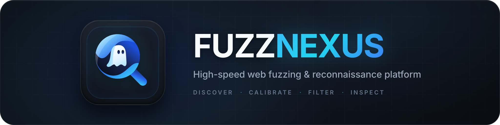
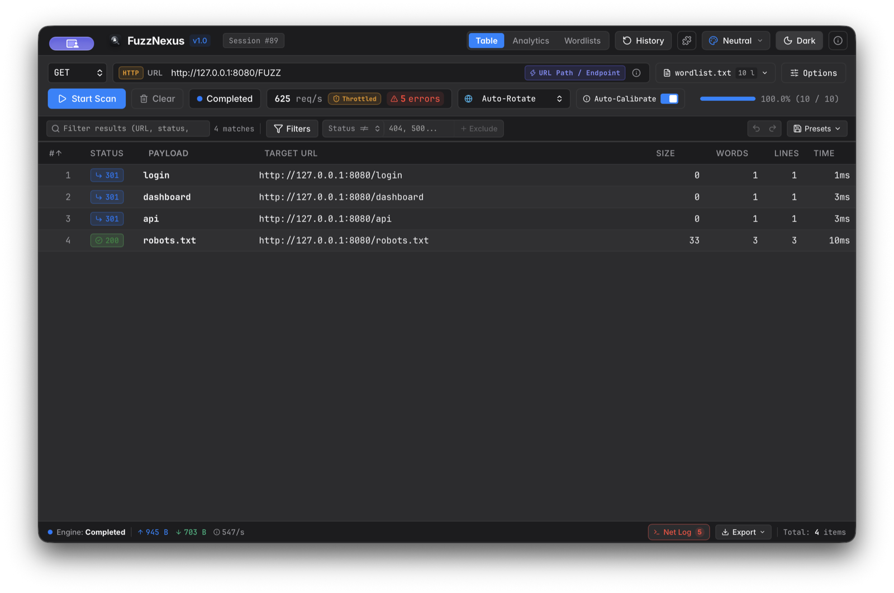
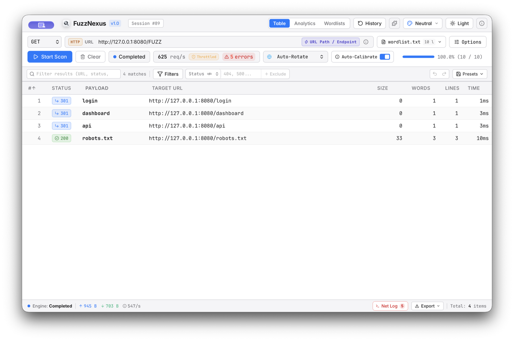
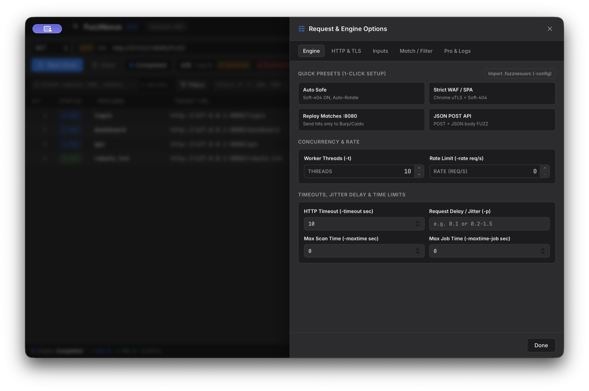
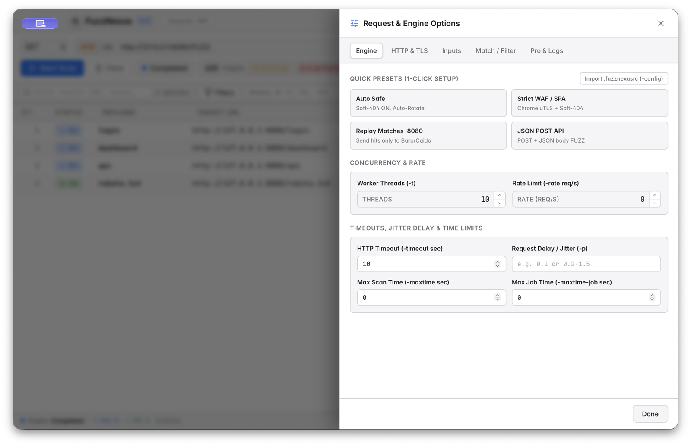
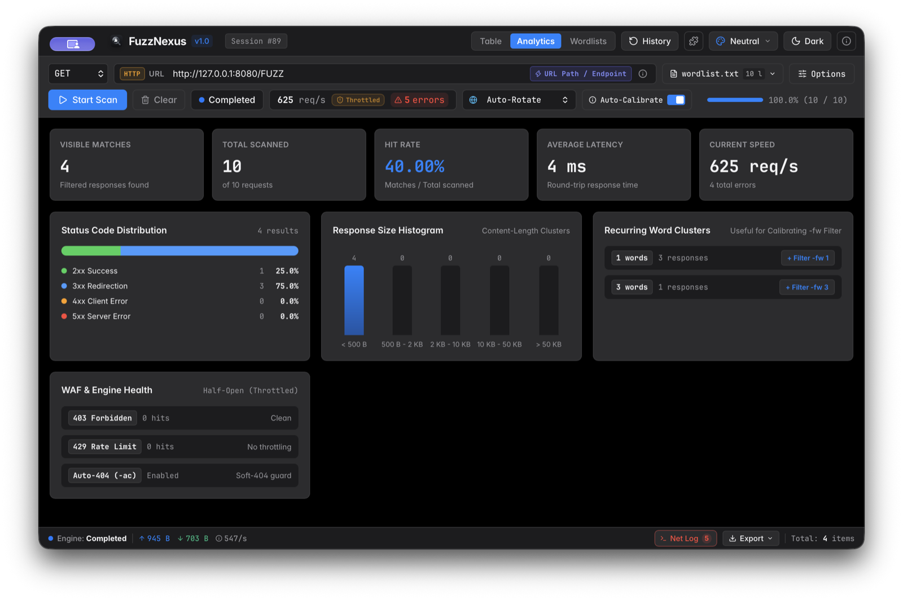
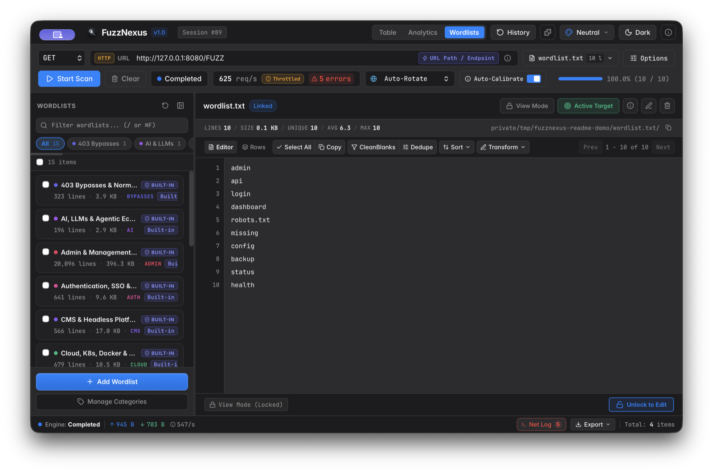

<p align="center">
  
</p>

<p align="center"><strong>Open-source web fuzzing and reconnaissance for the CLI and desktop.</strong></p>

FuzzNexus is a web fuzzing and reconnaissance tool with a Go command-line
engine and a cross-platform desktop application. The CLI and desktop app share
the same scanning engine, request runner, matching and filtering logic, and
output pipeline.

The desktop application is built with Wails v2, Svelte 5, TypeScript, and
SQLite. It provides a graphical workflow for configuring scans, managing
wordlists, monitoring results, and inspecting requests and responses.

## What it supports

- URL, header, host, parameter, and POST-body fuzzing with the `FUZZ` keyword
- Multiple wordlists with clusterbomb, pitchfork, and sniper modes
- Response matchers and filters for status, size, words, lines, regex, and time
- Recursive scanning, auto-calibration, rate limiting, request delays, and
  circuit-breaker safeguards
- HTTP/1.1, HTTP/2, proxying, replay proxies, client certificates, and selectable
  TLS client profiles
- Preflight and postflight requests with response-variable extraction
- JSON Lines, JSON, HTML, Markdown, CSV, and extended CSV output formats
- Audit logs containing request, response, and configuration data
- A desktop interface with persistent sessions, wordlist management, live
  results, filters, and request/response inspection

## Download

Prebuilt desktop binaries and SHA-256 checksums are published on the [GitHub Releases](https://github.com/ParsaAzari/FuzzNexus/releases/tag/v1.0.2) page:

| Platform | Architecture | Download |
|---|---|---|
| [](https://github.com/ParsaAzari/FuzzNexus/releases/download/v1.0.2/FuzzNexus-1.0.2-macOS-Universal.dmg) | Apple Silicon & Intel | [FuzzNexus-1.0.2-macOS-Universal.dmg](https://github.com/ParsaAzari/FuzzNexus/releases/download/v1.0.2/FuzzNexus-1.0.2-macOS-Universal.dmg) |
| [](https://github.com/ParsaAzari/FuzzNexus/releases/download/v1.0.2/FuzzNexus-1.0.2-Windows-x64.zip) | 64-bit (`amd64`) | [FuzzNexus-1.0.2-Windows-x64.zip](https://github.com/ParsaAzari/FuzzNexus/releases/download/v1.0.2/FuzzNexus-1.0.2-Windows-x64.zip) |
| [](https://github.com/ParsaAzari/FuzzNexus/releases/download/v1.0.2/FuzzNexus-1.0.2-Linux-x86_64.tar.gz) | 64-bit (`x86_64`) | [FuzzNexus-1.0.2-Linux-x86_64.tar.gz](https://github.com/ParsaAzari/FuzzNexus/releases/download/v1.0.2/FuzzNexus-1.0.2-Linux-x86_64.tar.gz) |

Verify integrity with [FuzzNexus-1.0.2-SHA256SUMS.txt](https://github.com/ParsaAzari/FuzzNexus/releases/download/v1.0.2/FuzzNexus-1.0.2-SHA256SUMS.txt). For first-launch instructions, filtering tips, and CLI examples, see the [User Guide](docs/USER_GUIDE.md).

## Quick start

### CLI

The CLI requires Go 1.26 or newer.

```bash
go build -o fuzznexus .
./fuzznexus -w wordlist.txt -u https://example.org/FUZZ -mc all -c -v
```

For a complete list of options:

```bash
./fuzznexus -h
```

A few common examples:

```bash
# Fuzz a path and filter responses with a specific size.
./fuzznexus -w wordlist.txt -u https://example.org/FUZZ -mc all -fs 42

# Fuzz the Host header.
./fuzznexus -w hosts.txt -u https://example.org/ -H "Host: FUZZ" -mc 200

# Fuzz JSON POST data and filter responses containing an error message.
./fuzznexus -w entries.txt -u https://example.org/ \
  -X POST -H "Content-Type: application/json" \
  -d '{"name":"FUZZ"}' -fr "error"
```

### Desktop application

Desktop development requires Go, Node.js/npm, and the [Wails CLI][wails]. From
the repository root:

```bash
cd fuzznexus-desktop
wails dev
```

Create a production build with:

```bash
wails build -clean
```

Wails places platform-specific artifacts under
`fuzznexus-desktop/build/bin/`. For example, a macOS application bundle is
`fuzznexus-desktop/build/bin/FuzzNexus.app`.

## Screenshots

The desktop interface supports both light and dark themes and keeps scan
results, configuration, analytics, and wordlists in one workflow.

<p align="center">
  
  
</p>
<p align="center"><em>Live scan results in dark and light themes.</em></p>

<p align="center">
  
  
</p>
<p align="center"><em>Request, engine, concurrency, rate, timeout, and preset controls.</em></p>

<p align="center">
  
  
</p>
<p align="center"><em>Analytics and built-in wordlist management.</em></p>

## Development

The repository contains two Go modules: the root module hosts the shared engine
and CLI, while `fuzznexus-desktop/` hosts the Wails backend. The desktop
frontend lives in `fuzznexus-desktop/frontend/`.

Useful checks from the repository root:

```bash
# Run the complete standard test suite, including race detection.
make test

# Run formatting, build, vet, and tests.
make check

# Run the frontend checks directly.
cd fuzznexus-desktop/frontend
npm run check
npm test -- --run
npm run build
```

The optional `testlab` target runs tagged integration and performance tests.
Some of those tests require Docker and locally available test services:

```bash
make testlab
```

### Test layout

The repository keeps its test layers separate by purpose:

- `test/` contains deterministic integration and black-box end-to-end tests.
- `testdata/` contains characterization and golden fixtures checked by CI.
- `testlab/` contains optional, build-tagged WAF, network, Docker, soak, and
  benchmark tests. It is intentionally outside the standard test command.
- `scripts/` contains repeatable build, packaging, wordlist, and repository
  validation helpers.

Before submitting a change, also review the project conventions in
[CONTRIBUTING.md](CONTRIBUTING.md), the component boundaries in
[docs/ARCHITECTURE.md](docs/ARCHITECTURE.md), and the security reporting process
in [SECURITY.md](SECURITY.md).

## Repository layout

```text
.
├── main.go, help.go       CLI entry point and help text
├── pkg/                   Shared configuration, engine, runner, filters, and output
├── test/                  Integration and end-to-end tests
├── testlab/               Optional tagged WAF and network test lab
├── fuzznexus-desktop/     Wails backend and Svelte frontend
├── docs/                  User guide, architecture, and third-party license notes
└── scripts/               Build, packaging, and repository checks
```

## Responsible use

Only scan systems you own or have explicit permission to test. FuzzNexus sends
the requests described by the operator and can generate significant traffic;
use conservative concurrency and rate limits when testing production systems.

## License

FuzzNexus is licensed under the [MIT License](LICENSE). The project retains
attribution for core components derived from `ffuf`; see [NOTICE](NOTICE) for
details.

[wails]: https://wails.io/
